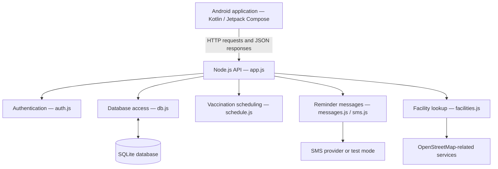
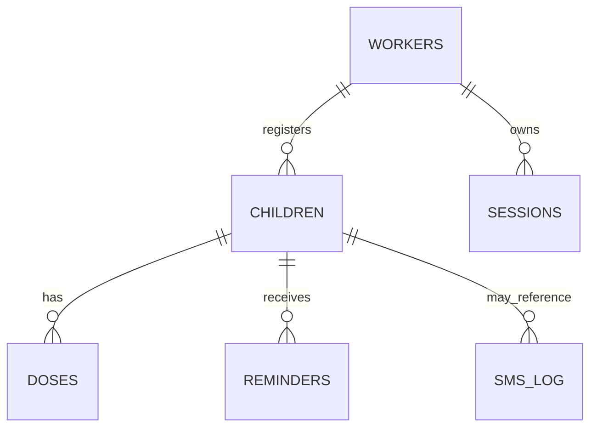
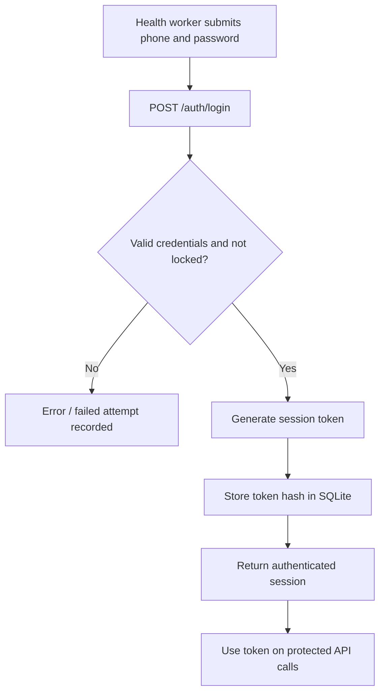

# VaccineReminder — Backend, Database and Authentication Documentation

**Assigned module:** Backend, Database and Authentication  
**Contributor:** Barbara  
**GitHub branch:** `feature/backend-improvements`  
**Document status:** Source-code review draft; practical testing pending  
**Source reviewed:** `VaccineReminder-master.zip` (snapshot uploaded 15 November 2026)

> This document describes the implementation visible in the supplied source-code snapshot. It does not claim that tests were executed or that the deployed service was verified. Barbara should review the document and add her own observations and verified test results before submission.

## 1. Introduction and scope

VaccineReminder supports childhood vaccination tracking in Kenya. Its Android client communicates with a Node.js backend that handles healthcare-worker authentication, child registration and retrieval, vaccination dose tracking, reminders, and nearby facility information. The backend uses SQLite for persistent records.

The backend package specifies Node.js **22.13 or later** and uses JavaScript ES modules. Its `package.json` provides `npm start`, `npm test`, and `npm run seed` commands. SQLite access is through the built-in `node:sqlite` `DatabaseSync` API rather than a separately listed SQLite ORM.

**Relevant files:** `backend/src/index.js`, `app.js`, `db.js`, `auth.js`, `schedule.js`, `messages.js`, `sms.js`, `facilities.js`, and `seed.js`.

## 2. Backend architecture



The API handler in `app.js` dispatches requests by HTTP method and URL path. The application supports a `POST` request with the `X-HTTP-Method-Override` header for `PATCH` or `DELETE`, as noted in the source, to accommodate the Android networking implementation.

## 3. Database structure

`openDb()` in `backend/src/db.js` opens the SQLite database (default file `vaccine.db`), enables foreign-key enforcement, sets a busy timeout, and creates the tables below if absent. The schema has a versioning mechanism using `PRAGMA user_version` with `SCHEMA_VERSION = 2` and incremental column additions.

| Table | Purpose | Selected fields |
|---|---|---|
| `children` | Child and caregiver registration | `id`, `child_name`, `caregiver_name`, `phone`, `dob`, `language`, `facility`, `consent`, `registered_by`, area fields |
| `doses` | Scheduled and administered vaccine doses | `id`, `child_id`, `code`, `name`, `due_date`, `given_date` |
| `reminders` | Records reminder milestones and their status | `id`, `child_id`, `due_date`, `kind`, `status`, `sent_at`, `run_date` |
| `sms_log` | SMS delivery attempts and provider responses | `id`, `phone`, `message`, `status`, `response`, `created_at`, `child_id`, `kind` |
| `workers` | Healthcare-worker accounts | `id`, `name`, `phone`, `facility`, `password_hash`, `last_login_at` |
| `sessions` | Active worker sessions | `token_hash`, `worker_id`, `created_at`, `expires_at` |

### Entity relationship diagram



`doses.child_id` and `reminders.child_id` reference `children.id` with cascading deletion. `sessions.worker_id` references `workers.id` with cascading deletion. `children.registered_by` references a worker and becomes null if that worker is removed; `sms_log.child_id` similarly uses `ON DELETE SET NULL`. The SMS log can therefore retain records without retaining a deleted child reference.

The database defines indexes for child phone lookup, pending doses, and SMS history. A unique `(child_id, code)` constraint prevents duplicate dose codes for a child; a unique `(child_id, due_date, kind)` constraint prevents duplicate reminder milestone records. These are database-level constraints, not a guarantee of end-to-end SMS delivery.

The source also implements `purgeExpiredAreas()`, which clears saved area coordinates and labels after **14 days**.

## 4. Healthcare-worker authentication

`backend/src/auth.js` implements password hashing, verification, password rules, token generation, and a rate-limiter utility.

- Passwords are hashed with **scrypt** using a random 16-byte salt and a 64-byte derived key; the stored string includes the algorithm, salt and hash.
- Passwords must be **8–128 characters** and contain both letters and numbers.
- New session tokens are randomly generated; only their **SHA-256 hashes** are stored in the `sessions` table.
- `SESSION_DAYS` is set to **30** in `auth.js`.
- Registration requires a configured registration code, as checked in `app.js`.
- After **five incorrect login attempts** for a phone number, the login route returns a temporary lockout response; its message specifies **15 minutes**.
- Changing a password deletes other sessions for the worker, while retaining the current session.

### Authentication flow



These measures are present in the code. This document does **not** claim the application has undergone an external security audit.

## 5. Vaccination schedule and record management

`backend/src/schedule.js` defines vaccination schedule calculations. `backend/src/db.js` uses `planDueDates()` and `replanChild()` to compute or recompute due dates based on date of birth and recorded administered doses. When a dose is recorded late, subsequent doses in a series may be shifted to maintain minimum spacing.

On successful `POST /children`, the backend inserts a child, creates scheduled dose rows from the schedule, and replans due dates within a database transaction. Staff can record one or more administered doses, mark a dose given, or undo a recorded dose. A child's date of birth update may also trigger rescheduling.

The `/due` route returns upcoming due doses within a requested window (default seven days, bounded to 0–60 days); `/missed` returns children with overdue unadministered doses. `/stats` aggregates totals for dashboard use.

## 6. API endpoint reference

The following routes are visible in `backend/src/app.js`. Routes listed after authentication handling require a valid worker session unless otherwise specified by the code.

| Method | Endpoint | Purpose | Access / input overview |
|---|---|---|---|
| GET | `/health` | Server health and SMS mode | Public |
| POST | `/caregiver/lookup` | Look up child information | Caregiver verification data, including phone and child DOB |
| POST | `/caregiver/location` | Save or clear caregiver area | Verified caregiver details; coordinates or null |
| GET | `/facilities/nearby` | Find nearby healthcare facilities | Latitude and longitude query parameters |
| GET | `/geocode` | Search for a town/place | `q` query parameter |
| POST | `/auth/register` | Register healthcare worker | Name, phone, facility, password, registration code |
| POST | `/auth/login` | Start worker session | Phone and password |
| GET | `/auth/me` | Retrieve current worker | Authenticated worker |
| POST | `/auth/logout` | End current session | Authenticated worker |
| POST | `/auth/password` | Change password | Current and new password; authenticated worker |
| GET | `/stats` | Dashboard summary | Authenticated worker |
| POST | `/children` | Register child and generate doses | Child and caregiver details; consent required |
| GET | `/children` | Search/filter registered children | Optional `q` and `filter` |
| GET | `/children/:id` | Get child and dose history | Child ID |
| PATCH | `/children/:id` | Update child details | Changed fields |
| DELETE | `/children/:id` | Delete child record | Child ID |
| POST | `/children/:id/doses` | Record multiple administered doses | Array of given dose records |
| POST | `/children/:id/doses/:code/given` | Mark dose given | Dose code and optional date |
| POST | `/children/:id/doses/:code/undo` | Undo recorded dose | Dose code |
| GET | `/missed` | List missed vaccinations | Authenticated worker |
| GET | `/due` | List upcoming vaccinations | Optional `days` |
| POST | `/reminders/run` | Process due reminders | Authenticated worker |
| POST | `/children/:id/remind` | Send manual reminder | Child ID; consent and rate limits apply |

**Request/response example (illustrative, not a captured test result):** A valid `POST /auth/login` request sends the worker's phone and password; the backend checks the credentials and returns session information on success. Do not put real passwords or tokens into documentation or screenshots.

## 7. Reminders and SMS integration

Reminder processing uses pending doses, due dates, caregiver consent, message generation, and SMS delivery. The source maintains both a `reminders` table for milestone tracking and `sms_log` for sending outcomes. A manual reminder route checks consent, requires a pending dose, and limits repeated successful manual reminders within **12 hours**.

The SMS and nearby-facility components are covered in greater depth by Stacey's assigned documentation. This section explains their place in the backend architecture without duplicating that module's detailed analysis.

## 8. Testing and validation plan

The repository includes these test suites:

- `backend/test/api.test.js`: authentication, registration, validation, dose statuses, scheduling, reminders, dashboard and migration scenarios.
- `backend/test/facilities.test.js`: nearby facilities, fallback providers, geocoding, saved area and location-related reminder behaviour.
- `backend/test/seed.test.js`: demonstration data through the API.

The following table is a **testing plan**, not a report of executed results.

| Test ID | Test scenario | Expected outcome | Actual result | Status |
|---|---|---|---|---|
| BT01 | Register worker with valid registration code | Account and session created | Not executed for this document | Pending |
| BT02 | Login with incorrect password | Error; repeated attempts eventually locked | Not executed for this document | Pending |
| BT03 | Login with valid credentials | Session returned | Not executed for this document | Pending |
| BT04 | Register child with valid consent | Child and scheduled doses created | Not executed for this document | Pending |
| BT05 | Register child without required consent | Validation error | Not executed for this document | Pending |
| BT06 | Mark a dose given | Dose recorded and schedule recalculated if needed | Not executed for this document | Pending |
| BT07 | Query overdue doses | Overdue unadministered doses listed | Not executed for this document | Pending |
| BT08 | Logout then reuse session | Session rejected | Not executed for this document | Pending |
| BT09 | Open older database version | Schema upgraded as implemented | Not executed for this document | Pending |

### How to run backend tests

From the repository root:

```bash
cd backend
npm test
```

The package specifies Node.js 22.13 or later. Record the Node version, command output, test totals, and date when tests are actually run. Do not claim passing results merely because test files exist.

## 9. Security and data protection considerations

**Implemented protections visible in the source:** salted scrypt password hashing, hashed session tokens, credential validation, login throttling, caregiver verification for caregiver-specific endpoints, SQLite foreign keys, consent checks for SMS, and automatic expiration of stored area data.

**Risks to evaluate:** protection of production registration codes and SMS credentials, HTTPS/TLS deployment, access to the SQLite database and backups, handling of caregiver/child personal information, audit logging, and data retention policies. These are review considerations, not claims of confirmed vulnerabilities.

For screenshots or reports, use synthetic data rather than real children's names, dates of birth, or caregiver phone numbers.

## 10. Deployment and operational considerations

The backend can be started using `npm start` from the `backend` directory, subject to the environment configuration described in the project's README and entry-point code. The Android client needs a reachable backend URL. An SMS provider integration may require credentials; tests and demonstration modes should be clearly distinguished from real SMS delivery.

The SQLite database is stored in a local database file by default. Production operation requires appropriate file permissions, backups, monitoring, and a secure hosting arrangement. These are operational recommendations rather than features verified by this document.

## 11. Challenges and recommendations

1. **Protect sensitive data:** document secure handling of account credentials, SMS secrets and child/caregiver records.
2. **Improve deployment documentation:** maintain clear configuration and troubleshooting instructions for Android-to-backend connectivity.
3. **Record test evidence:** attach actual test output and reproducible steps before claiming verification.
4. **Plan database operations:** define backups, recovery checks and migration procedures for real deployments.
5. **Review access controls:** confirm which health workers should see which child records in the intended deployment model.

## 12. Conclusion

The supplied VaccineReminder backend combines an HTTP API, SQLite storage, healthcare-worker authentication, vaccination scheduling, reminder processing, and healthcare-facility lookup. The code demonstrates a structured approach to tracking children and their vaccination doses, supporting authenticated healthcare workers and caregiver reminder workflows. Further runtime testing and deployment verification are needed before making claims about production readiness.

## 13. Source file references

- `backend/package.json`
- `backend/src/app.js`
- `backend/src/auth.js`
- `backend/src/db.js`
- `backend/src/schedule.js`
- `backend/src/messages.js`
- `backend/src/sms.js`
- `backend/src/facilities.js`
- `backend/test/api.test.js`
- `backend/test/facilities.test.js`
- `backend/test/seed.test.js`

**Contributor review checklist:** Confirm the document matches the current repository; inspect the source files personally; add observations and real test results where available; check diagrams and tables; submit only the documentation file to `feature/backend-improvements`.
