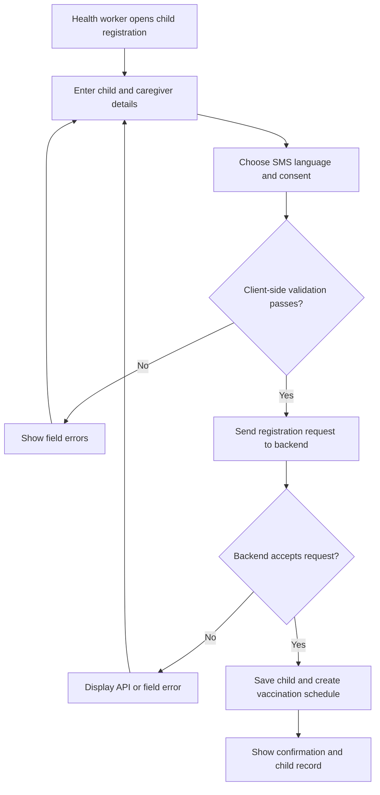

# Child Registration and Vaccination Management

**Project:** VaccineReminder — SMS-Based Childhood Vaccination Reminder System  
**Contributor:** Haniiffah  
**Module:** Child Registration and Vaccination Management  
**GitHub branch:** `feature/child-management`  
**Document type:** Source-code review and testing plan  
**Status:** Draft for contributor review; tests have not been executed as part of this document.

## 1. Introduction

The VaccineReminder application supports recording children and monitoring their vaccination schedules. Its Android application is written in Kotlin using Jetpack Compose and communicates with a backend API. This document describes the child registration and vaccination management features visible in the project source code, outlines tests to carry out, and identifies areas for review.

Accurate records matter because vaccination dates are calculated relative to a child's date of birth, and caregivers need reliable information about scheduled and administered doses.

## 2. Source files reviewed

| File | Role |
|---|---|
| `android/app/src/main/java/ke/vaccinereminder/ChildScreens.kt` | Child registration/edit form, child details, vaccination display and dose actions |
| `android/app/src/main/java/ke/vaccinereminder/WorkerScreen.kt` | Health-worker dashboard, child listing, search/filtering and follow-up interface |
| `android/app/src/main/java/ke/vaccinereminder/Api.kt` | Android API calls and data structures |
| `android/app/src/main/java/ke/vaccinereminder/Format.kt` | Date, phone and display-format helpers |
| `backend/src/app.js` | API routes, backend validation, child persistence and dose updates |

## 3. Child registration process

The `ChildFormScreen` composable supports both registration of a new child and editing an existing record. For a new record, the screen gathers:

- Child's name
- Date of birth
- Caregiver's name
- Caregiver's phone number
- Facility (a text field)
- SMS language preference: English or Kiswahili
- Caregiver consent for SMS reminders

The facility field is presented in the form, but the client-side `validate()` function does not treat it as a required field. When editing an existing record, the form loads current values from the API before saving changes.

### Registration workflow

The diagram summarizes the code path; the exact visual transitions should be confirmed in the running application.

## 4. Validation and data quality

### Android-side checks

`ChildFormScreen.validate()` checks that the child's name, date of birth and caregiver's name are not blank, and that the caregiver phone number can be normalized. On a new registration, consent must be selected. Validation errors appear against the relevant fields.

The date picker is configured with a range from approximately five years before the current Nairobi date through today. A separate backend check enforces date-format and age constraints.

### Backend-side checks

In `backend/src/app.js`, backend validation includes:

- Date of birth must be in `YYYY-MM-DD` format.
- Date of birth must not be in the future or more than five years in the past.
- A new registration requires caregiver SMS consent.
- A duplicate check compares normalized phone number, date of birth and child name (case-insensitively).
- A duplicate child registration can return an HTTP 409 conflict.

**Observation:** Validation must be checked at both the Android and backend levels. A field being present on the screen does not necessarily mean it is mandatory.

## 5. Child records and health-worker workflow

The worker interface in `WorkerScreen.kt` includes child-related navigation, a children list and a follow-up area. The list retrieves records through the API and presents child information such as the child's name, caregiver details, progress and next due date where available. The code also provides filtering and navigation to an individual child's details.

The child details screen (`ChildDetailScreen`) retrieves an individual record and displays the child's name, age, date of birth, caregiver information, facility when supplied, SMS consent status and preferred language. It also displays vaccination progress and next-visit information.

The details screen includes actions for editing and deleting a record, with deletion confirmation, and for managing vaccination doses. These actions should be demonstrated with synthetic test records only.

## 6. Vaccination schedule and dose management

The backend stores dose information associated with children. The API supports retrieving child details, managing dose records, and marking or undoing administered doses. When a child's date of birth is changed, the backend can replan the schedule, subject to checks preventing a recorded dose date from preceding the child's date of birth.

In the Android child detail screen, vaccination information is used to show overdue doses, vaccination progress and the next scheduled visit. The system also exposes a reminder action when the caregiver has consented and there is a next due date.

**Scope note:** Exact vaccine names, intervals and full schedule rules should be checked against `backend/src/schedule.js` before making claims about particular national immunisation dates.

## 7. Proposed test cases

These are **planned tests**, not claims of successful execution. Record actual observations after testing the app against a safe test backend.

| ID | Test scenario | Expected result | Actual result | Status |
|---|---|---|---|---|
| CR01 | Register a child with valid data and consent | New record is created and displayed | Not tested | Pending |
| CR02 | Leave child name blank | Field validation message appears | Not tested | Pending |
| CR03 | Leave caregiver name blank | Field validation message appears | Not tested | Pending |
| CR04 | Enter an invalid phone number | Phone validation message appears | Not tested | Pending |
| CR05 | Do not grant consent during new registration | Registration is blocked with a consent message | Not tested | Pending |
| CR06 | Select a future birth date or submit one to the API | Invalid date is rejected | Not tested | Pending |
| CR07 | Attempt duplicate registration | Backend rejects duplicate child | Not tested | Pending |
| CR08 | Open a registered child's details | Correct child and caregiver information is shown | Not tested | Pending |
| CR09 | Edit an existing child's information | Updated details are saved and shown | Not tested | Pending |
| CR10 | View vaccination schedule and progress | Schedule and status information display | Not tested | Pending |
| CR11 | Mark a dose administered using test data | Dose status updates correctly | Not tested | Pending |
| CR12 | Undo a recorded dose using test data | Dose status reverts correctly | Not tested | Pending |
| CR13 | Cancel a deletion confirmation | Child record remains intact | Not tested | Pending |
| CR14 | Disconnect backend while loading child details | Error/retry state is presented | Not tested | Pending |

### Suggested test record

Use fictional information only, such as `Test Child A`, `Test Caregiver A`, a permitted test phone number and a synthetic date of birth. Do not use real children's personal data or send real SMS messages during testing without authorization.

### Test execution record

- **Tester:** Haniiffah
- **Test date:** To be completed
- **Android device/emulator:** To be completed
- **Backend environment:** To be completed
- **Tests passed:** Not yet measured
- **Tests failed:** Not yet measured
- **Evidence/screenshots:** To be added after testing

## 8. User experience review checklist

When reviewing the running application, evaluate the following:

1. Are child and caregiver fields clearly labelled?
2. Is the date-of-birth picker understandable?
3. Are validation messages readable and specific?
4. Is the SMS consent explanation clear?
5. Can a health worker find a previously registered child quickly?
6. Are next visits, overdue doses and administered doses distinguishable?
7. Is the edit flow understandable and safe?
8. Does the screen remain usable on smaller Android devices?

**Observations:** To be completed by Haniiffah after inspecting the application.

## 9. Findings and potential improvements

The source code demonstrates separation between the Android form and backend validation, consent handling for new registration, a duplicate-record check, and API-based management of child and dose records. These are observations from code inspection rather than confirmed end-to-end test results.

Potential areas for future evaluation include clearer feedback when the backend is unavailable, usability of the birth-date selection, clarity of vaccination statuses, and consistency of validation messages. Any proposed changes should be discussed with the project lead; this documentation task does not require source-code edits.

## 10. Conclusion

The child registration and vaccination management module provides the workflow for recording children, associating them with caregivers, viewing vaccination information and maintaining dose records. The Android interface and backend share responsibility for validation and data management. A final assessment of correctness and usability requires execution of the planned tests and recording their actual results.

---

### Contributor review before submission

- [ ] Read this document and correct any descriptions that differ from the running application.
- [ ] Perform any tests that are feasible and update actual results honestly.
- [ ] Add screenshots only if they contain no real personal information.
- [ ] Commit only this documentation file to `feature/child-management`.
- [ ] Open a pull request to `master` for Andrew to review.
