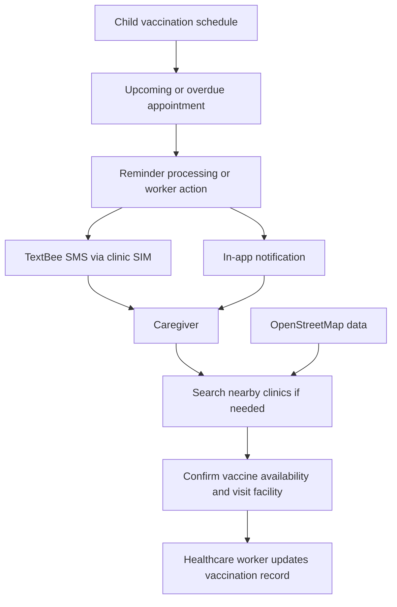

# VaccineReminder — SMS Reminders, Notifications and Healthcare Facilities

**Contributor:** Stacey  
**Assigned branch:** `feature/reminders-facilities`  
**Project:** SMS-Based Vaccination Reminder System in Kenya  
**Status:** Documentation draft for contributor review; runtime testing pending.

## 1. Introduction

VaccineReminder helps caregivers and healthcare workers track childhood vaccination appointments. This module focuses on communication and access to healthcare facilities. It combines SMS reminders, in-app notifications and nearby clinic searches to help caregivers plan visits and respond to missed appointments.

## 2. SMS reminder system

The application supports reminders three days before a scheduled vaccination, on the due date and when an appointment has been missed. Healthcare workers can also send reminders manually from the dashboard, a child's record or the follow-up page. Automatic sending can be disabled; in that mode, a worker must initiate SMS delivery.

The reminder workflow is intended to use the child's vaccination schedule, caregiver phone number, SMS preferences and vaccination status. Completed doses should no longer generate reminders for the same appointment. English and Kiswahili support helps caregivers receive information in their preferred language.

## 3. TextBee integration and costs

The current project uses TextBee to send SMS through a SIM-enabled phone. SMS delivery consumes airtime from the clinic's SMS phone. According to the project team's cost description, this is the only paid service in the current project setup. Caregivers do not pay for receiving the project's ordinary SMS reminders. Actual sending costs depend on the SIM provider and tariff.

SMS is particularly useful for caregivers who use basic mobile phones or do not have mobile internet. Delivery still requires a valid, reachable phone number and mobile network service. Sending a message does not guarantee that the recipient has read it.

## 4. In-app notifications

Healthcare workers can send an in-app notification from a child's record, using either the usual reminder or an optional custom message. The caregiver must have found the child in the application and selected the option to remember the child on that phone.

The displayed interface indicates that clinic messages are checked approximately every 15 minutes and when the caregiver opens the app. Vaccine alerts for upcoming or missed appointments are checked approximately every 12 hours. The caregiver can also select **Check now** to request an immediate check. Delivery may depend on connectivity, notification permissions and Android background restrictions.

Unlike SMS, in-app notifications do not consume SMS airtime. They complement rather than replace SMS, because a caregiver without a compatible smartphone or internet connection may not receive them.

## 5. Healthcare worker follow-up

The dashboard displays upcoming vaccinations, missed vaccinations and SMS activity. The Follow-up page lists children with overdue vaccinations, prioritizing those overdue the longest. Healthcare workers can call caregivers or send SMS reminders directly from the list. This helps staff prioritize follow-up and reduces the need to manually search through vaccination records.

## 6. Nearby healthcare facilities

Caregivers can open **Clinics near me**, search for a town or use their current location to find nearby mapped hospitals and clinics. The feature is useful when families travel or are away from their usual healthcare facility. The application also provides a facility selection interface for relevant registration and child-record workflows.

The mapping data is provided by OpenStreetMap. OpenStreetMap data is free to use subject to its licence and attribution requirements. The application displays the required attribution:

**© OpenStreetMap contributors**

OpenStreetMap does not establish whether a facility has a particular vaccine in stock. Caregivers should contact the facility to confirm availability before visiting. Mapping coverage may be incomplete or outdated.

## 7. Conceptual system workflow

This diagram describes the intended functional workflow rather than exact internal API calls.

## 8. Technology and service overview

| Component | Purpose |
|---|---|
| Kotlin and Jetpack Compose | Android screens and user interaction |
| Node.js | Backend processing and communication |
| SQLite | Persistent vaccination and reminder records |
| TextBee | SMS gateway using a SIM-enabled phone |
| OpenStreetMap | Geographic and healthcare facility data |

## 9. Testing plan

The following tests should be performed with fictional child records and authorized test phone numbers. No test result is claimed in this draft.

| ID | Test scenario | Expected result | Status |
|---|---|---|---|
| RF01 | Vaccination due in three days | Eligible automatic reminder is processed when enabled | Pending |
| RF02 | Vaccination due today | Eligible due-date reminder is processed | Pending |
| RF03 | Missed vaccination | Child appears in follow-up; eligible reminder is processed | Pending |
| RF04 | Automatic SMS disabled | No automatic SMS; manual sending remains available | Pending |
| RF05 | Manual SMS to test phone | Delivery attempt recorded; receipt confirmed on test phone | Pending |
| RF06 | SMS consent disabled | Reminder sending respects the caregiver's preference | Pending |
| RF07 | Send in-app notification | Eligible caregiver device displays the message | Pending |
| RF08 | Caregiver has no remembered device | Interface warns that notification may not arrive | Pending |
| RF09 | Switch SMS language | Reminder uses selected supported language | Pending |
| RF10 | Search clinics by town | Relevant mapped facilities or a clear empty state | Pending |
| RF11 | Search using current location | Nearby results or graceful permission/error handling | Pending |
| RF12 | Inspect map attribution | © OpenStreetMap contributors is visible | Pending |
| RF13 | Record administered vaccine | Completed dose no longer triggers unnecessary reminders | Pending |
| RF14 | SMS gateway or network unavailable | Failure handled without claiming successful delivery | Pending |

## 10. Security, privacy and limitations

- Protect caregiver phone numbers and children's medical information.
- Restrict reminder and notification functions to appropriately authorized users.
- Respect caregiver SMS preferences and location permissions.
- Keep gateway credentials and real patient data out of GitHub and test screenshots.
- Monitor SMS airtime, delivery failures and duplicate reminder attempts.
- Do not assume map results confirm vaccine availability or that sent messages have been read.

## 11. Recommendations

Future improvements could include delivery monitoring, retry controls, clearer notification delivery indicators, airtime monitoring and improved facility information. The team should test the complete reminder workflow and evaluate its practical effectiveness before making claims about reduced missed vaccinations.

## 12. Conclusion

SMS reminders, in-app notifications and nearby clinic searches make VaccineReminder more accessible to caregivers with different devices and internet access. Together, these features support healthcare worker follow-up and help families keep track of childhood vaccination appointments while keeping service costs low.

---

**Documentation basis:** Current application screenshots and project-team descriptions of TextBee, reminder behaviour, notification timing and OpenStreetMap. The latest source code and runtime behaviour have not been independently verified for this draft.

**Contributor review:** Stacey should verify the documentation against the running application, correct any differences, perform feasible tests and record actual results before committing this file. Submit documentation only; no application source-code changes are required for this assigned contribution.
