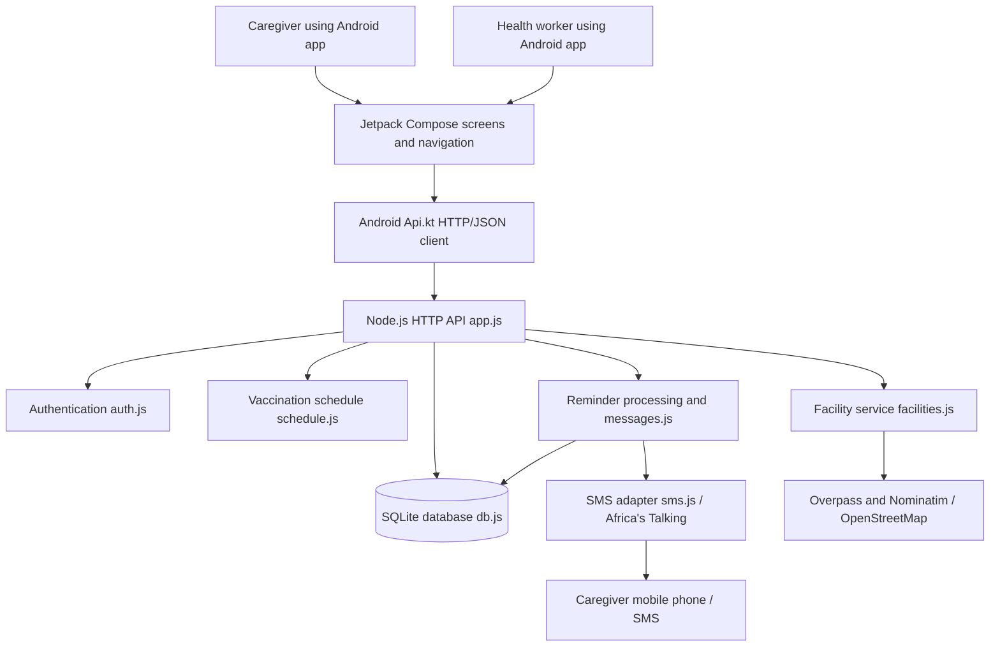
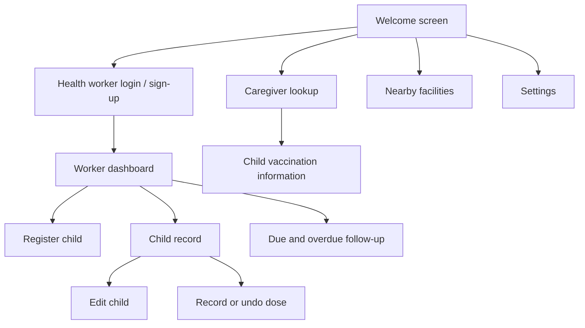
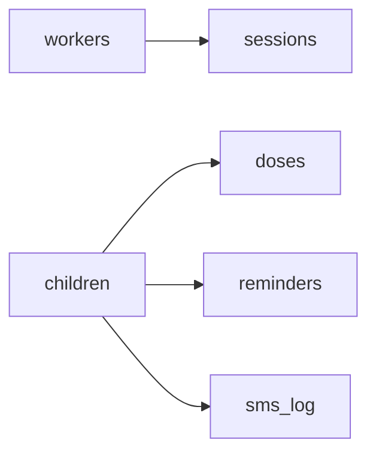
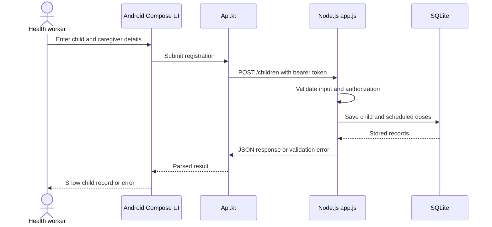
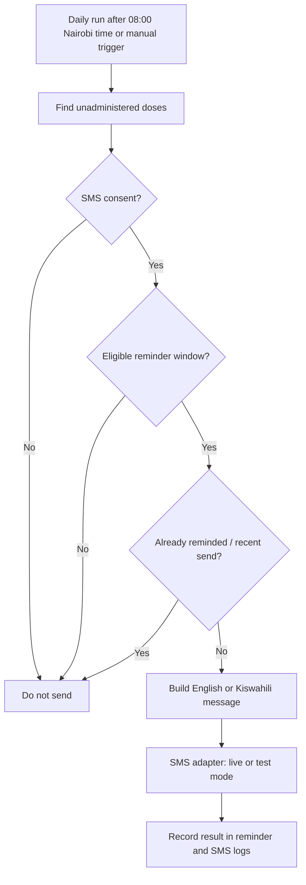

# VaccineReminder — System Architecture and Integration Documentation

**Project:** SMS-Based Vaccination Reminder System to Reduce Missed and Delayed Childhood Immunisation in Kenya  
**Prepared by:** Andrew  
**Role:** Project Lead, System Architecture and Integration  
**Repository:** `Supreme-sudo-sketch/VaccineReminder`  
**Assigned branch:** `feature/integration`  
**Document status:** Source-code review; runtime verification pending

## 1. Project overview

VaccineReminder is a prototype mobile and backend system intended to support childhood immunisation follow-up in Kenya. It enables healthcare workers to register children, record vaccine doses, monitor due and overdue appointments, and trigger reminders. Caregivers can look up a child's vaccination information using their phone number and the child's date of birth. SMS reminders are intended to reach basic mobile phones without requiring the caregiver to have mobile internet.

The system includes English and Kiswahili messages and screens, and a nearby-healthcare-facility feature that retrieves mapped facilities. It is a **prototype**, not a validated clinical decision-support system or evidence of improved vaccination coverage.

### Project objectives and implemented support

| Objective | Prototype implementation |
|---|---|
| Track childhood immunisation | Child registration, scheduled doses, dose recording and overdue views |
| Reduce missed appointments | Automated and manually triggered SMS reminders |
| Support caregiver access | Caregiver lookup by phone number and child date of birth |
| Support language accessibility | English and Kiswahili UI and SMS templates |
| Help locate facilities | Nearby facility lookup using OpenStreetMap-derived data |
| Support health workers | Authentication, dashboard statistics and follow-up lists |

## 2. Technology stack and repository structure

| Layer | Technology / relevant source |
|---|---|
| Android application | Kotlin, Jetpack Compose (`android/app/src/main/java/ke/vaccinereminder/`) |
| Android navigation | `MainActivity.kt`, Compose route/state handling |
| HTTP integration | `Api.kt`, `HttpURLConnection` and JSON parsing |
| Android local state | `Storage.kt`, application preferences and secure session/lookup storage |
| Backend runtime | Node.js 22.13+ (`backend/src/index.js`) |
| HTTP/API implementation | Node.js HTTP server (`backend/src/app.js`) |
| Persistence | SQLite (`backend/src/db.js`) |
| Worker authentication | `backend/src/auth.js` and API routes |
| Vaccine scheduling | `backend/src/schedule.js` |
| SMS delivery | `backend/src/messages.js`, `sms.js`, Africa's Talking integration |
| Facility search | `backend/src/facilities.js`, OpenStreetMap/Overpass/Nominatim |
| Automated backend tests | `backend/test/api.test.js`, `facilities.test.js`, `seed.test.js` |

The repository's `android/` folder is the Android Studio project. The `backend/` folder is the independently run server. The Android app does **not** directly access the SQLite database; it communicates with the backend over HTTP.

## 3. Overall system architecture



**Explanation:** The mobile UI gathers input and displays server responses. `Api.kt` serialises requests and parses responses. `app.js` implements the API and coordinates authentication, database queries, scheduling and reminder actions. `db.js` maintains persistent records. Facility lookups rely on external geographic services, and SMS delivery uses Africa's Talking when configured; otherwise SMS is logged in dry-run/test mode.

## 4. Android application architecture and navigation

`MainActivity.kt` creates the Compose application and manages navigation using a saved route stack. The route types include Welcome, Caregiver, Nearby, Login, SignUp, WorkerHome, RegisterChild, Settings, ChildDetail and EditChild. Health-worker-only screens are flagged as requiring a worker session.

Other important files include `WelcomeScreen.kt`, `CaregiverScreen.kt`, `AuthScreens.kt`, `WorkerScreen.kt`, `ChildScreens.kt`, `NearbyScreen.kt`, `SettingsScreen.kt`, `Alerts.kt`, `Theme.kt`, `Strings.kt`, `Storage.kt`, and `Components.kt`. The UI is built with **Jetpack Compose**, not XML screen layouts.



The diagram describes principal flows reflected in the code; it is not a pixel-perfect representation of every button or navigation path.

## 5. Backend and database architecture

The server entry point `backend/src/index.js` opens SQLite, creates the HTTP application, configures the facility client and starts listening on the configured port (default **3000**). It also checks periodically for the daily reminder run after **08:00 Nairobi time**.

`backend/src/db.js` creates or migrates these principal tables:

| Table | Role |
|---|---|
| `workers` | Health worker accounts |
| `sessions` | Authenticated sessions |
| `children` | Child, caregiver, consent and optional saved area details |
| `doses` | Vaccination schedule and administered-dose dates |
| `reminders` | Reminder events and statuses, including deduplication |
| `sms_log` | SMS attempts, statuses and message history |



This is a **conceptual relationship diagram**, not a complete field-level ERD. Consult `backend/src/db.js` for exact column definitions and constraints.

## 6. Mobile-to-backend API integration

The Android client calls the backend via `Api.kt`, using HTTP requests and JSON data. Worker routes use an authentication token in the `Authorization: Bearer <token>` header. The backend returns structured error objects with fields such as `error`, `code`, and `field`, allowing the UI to present validation feedback.

### Representative API routes

| Method | Route | Purpose |
|---|---|---|
| POST | `/auth/register` | Register a health worker with a registration code |
| POST | `/auth/login` | Authenticate a worker |
| GET | `/auth/me` | Retrieve current worker identity |
| POST | `/auth/logout` | End session |
| POST | `/caregiver/lookup` | Find a child's details using caregiver phone and child's date of birth |
| GET | `/stats` | Dashboard statistics |
| POST | `/children` | Register a child |
| GET | `/children` | Search/list children |
| GET | `/children/:id` | Child details and doses |
| PATCH | `/children/:id` | Update child details or SMS consent |
| POST | `/children/:id/doses/:CODE/given` | Record administered dose |
| GET | `/missed` | Overdue follow-up list |
| GET | `/due?days=7` | Upcoming due list |
| POST | `/children/:id/remind` | Manual reminder |
| POST | `/reminders/run` | Trigger reminder processing |
| GET | `/facilities/nearby` | Search mapped nearby facilities |
| GET | `/geocode` | Search Kenyan place names |
| POST | `/caregiver/location` | Save or remove caregiver's preferred reminder area |

**Access:** Most worker management endpoints require a worker bearer token. Caregiver lookup and facility search are public with safeguards described in the code and README. The exact access rules should be confirmed per route in `backend/src/app.js`.

### Example integration workflow: child registration



## 7. Vaccination scheduling and reminder workflow

The schedule logic is implemented in `backend/src/schedule.js`. The prototype assigns dose due dates and recalculates later doses in certain series when earlier doses are administered late. The README states a minimum four-week interval for supported vaccine series; these rules are prototype assumptions and **must be checked against the current Kenyan Ministry of Health immunisation schedule before real use**.

Reminder selection is implemented in `app.js` and `messages.js`. The documented windows are:

| Reminder kind | Eligibility window |
|---|---|
| Before | 1–3 days before due date |
| Due | On due date |
| Overdue | 3–13 days after due date |
| Follow-up | 14–60 days after due date |

The backend processes pending doses for children with SMS consent, prioritises eligible reminders, limits automated messages to one per child per day, and avoids repeat successful reminders for the same child/due date/kind. Manual reminders have additional recent-send safeguards. The backend records SMS outcomes. Without valid Africa's Talking configuration, messages are logged in test mode rather than delivered to real phones.



## 8. Nearby healthcare facility integration

`NearbyScreen.kt` and `Location.kt` support the Android-side location experience. `backend/src/facilities.js` queries OpenStreetMap-derived services via Overpass and Nominatim. The server searches for hospitals first and widens the search area; if necessary it falls back to clinics, other providers or cached results. Saved caregiver areas can be used to append nearby facilities to reminder SMS messages. The README describes a 14-day expiry for saved areas and location rounding to reduce precision.

**Critical limitation:** OpenStreetMap facility listings do **not** verify that a facility offers vaccinations or has vaccines in stock. Caregivers should call the facility to confirm availability.

## 9. Authentication, privacy and security considerations

The backend includes health worker registration/login, password handling, session tokens, login lockout after repeated incorrect passwords, and authenticated worker endpoints. Registration uses a shared registration code. Caregiver lookup relies on phone number and date of birth, which is a weaker identity check than full authentication.

The README identifies important production gaps: all registered health workers can access all children; there is no administrator approval and facility-scoped access control; some rate limits are in memory; HTTPS, data retention rules and formal data protection review are required for real deployment. The system handles personal data and must not be deployed with real child records without suitable security and legal review.

## 10. Installation, configuration and demonstration

### Backend

Prerequisite: Node.js **22.13 or newer**.

```bash
cd backend
npm test
REGISTRATION_CODE=replace-with-a-private-code npm start
```

On Windows PowerShell, set the variable separately:

```powershell
cd backend
$env:REGISTRATION_CODE = 'replace-with-a-private-code'
npm start
```

The backend listens on port 3000 unless `PORT` is configured. For a demonstration, leave live SMS credentials unset to use dry-run logging. Optional sample data can be created with `npm run seed` in the backend folder; **`npm run seed -- --reset` deletes existing records**, so use it only with a disposable demo database.

### Android

Open the **`android/`** folder in Android Studio and allow Gradle to sync. The repository README notes Android Studio Ladybug or newer and a Java 21 Gradle daemon configuration. Configure the application's backend address for the emulator or actual phone as described in the README. A physical device generally cannot reach a server on the development laptop using the laptop's `localhost` address.

### Demonstration sequence

1. Start backend in test SMS mode and confirm it is reachable.
2. Sign in as a demo health worker (using only synthetic demonstration data).
3. Register a child with caregiver SMS consent.
4. View generated vaccine schedule; record and undo a dose.
5. Look up the child through the caregiver interface.
6. Review due/overdue follow-up lists and trigger a reminder.
7. Inspect the resulting test-mode SMS history.
8. Demonstrate English/Kiswahili, themes and nearby facilities if network access is available.

## 11. Integration test plan and verification status

**No tests were executed as part of preparing this document.** The table below is a verification plan, not a claim of successful results. Record the date, device/environment and evidence when running each test.

| ID | Integration scenario | Expected behaviour | Actual result | Status |
|---|---|---|---|---|
| INT-01 | Start backend and connect Android client | Client can reach API | Not run | Pending |
| INT-02 | Login with valid worker credentials | Authenticated session and dashboard | Not run | Pending |
| INT-03 | Login with invalid credentials | Appropriate error, no session | Not run | Pending |
| INT-04 | Register child with valid data | Child and scheduled doses saved | Not run | Pending |
| INT-05 | Submit invalid child registration | Validation error returned/displayed | Not run | Pending |
| INT-06 | Record a dose and reload record | Dose appears as given | Not run | Pending |
| INT-07 | Lookup caregiver child record | Matching child shown after valid check | Not run | Pending |
| INT-08 | Withdraw SMS consent | Future reminders blocked | Not run | Pending |
| INT-09 | Trigger eligible reminder in test mode | Attempt logged; no live SMS sent | Not run | Pending |
| INT-10 | Query nearby facilities | Results or graceful network error | Not run | Pending |
| INT-11 | Switch English/Kiswahili | Supported interface strings change | Not run | Pending |
| INT-12 | Restart app and restore relevant state | Expected saved preferences/session behaviour | Not run | Pending |

The repository includes backend test suites in `backend/test/`. Running `npm test` and saving its actual output is recommended before final submission.

## 12. Limitations and future improvements

1. **Clinical schedule validation:** Confirm vaccine timing, upper age limits and catch-up rules against current Ministry of Health guidance.
2. **Access control:** Add administrator approval, account deactivation and health-facility-specific data access.
3. **Privacy:** Conduct a data protection impact assessment and implement appropriate retention, HTTPS and operational safeguards.
4. **SMS operations:** Validate live delivery, sender registration, costs, provider outages and retry behaviour before production.
5. **Facility coverage:** OpenStreetMap data can be incomplete, outdated or unavailable; it cannot confirm vaccine stock.
6. **Operational reliability:** Server scheduling depends on the backend process remaining active; in-app alerts may be delayed by Android battery restrictions.
7. **Impact evaluation:** The prototype has not established that it reduces missed vaccinations; a properly designed evaluation would be required.

## 13. Team collaboration and integration responsibilities

| Member | Assigned documentation responsibility |
|---|---|
| Andrew | System architecture, integration, project coordination and final review |
| Philip | UI/UX and Compose design documentation |
| Haniiffah | Child registration and vaccination management documentation |
| Barbara | Backend, database and authentication documentation |
| Stacey | SMS reminders, notifications and healthcare facilities documentation |

Each member should create their own documentation on their assigned feature branch and submit a pull request. Andrew reviews the changes and merges approved documents into `master`. Documentation contributions are distinct from writing the original application source code.

## 14. Conclusion

VaccineReminder integrates a Kotlin/Jetpack Compose Android interface with a Node.js HTTP backend, SQLite persistence, vaccination scheduling, SMS reminder processing and external facility lookup services. The design separates user interaction, API logic and data storage, supporting demonstration of a complete mobile-to-server workflow. Its limitations—including clinical schedule validation, access control, personal-data protection and operational reliability—must be addressed before any real-world healthcare deployment.

---

### Source files reviewed

- `README.md`
- `android/app/src/main/java/ke/vaccinereminder/MainActivity.kt`
- `android/app/src/main/java/ke/vaccinereminder/Api.kt`
- `backend/src/index.js`, `app.js`, `db.js`, `auth.js`, `schedule.js`, `messages.js`, `sms.js`, `facilities.js`
- `backend/package.json` and `backend/test/` directory

*Documentation is based on the uploaded repository ZIP. Screenshots, live test outcomes and deployment evidence should be added after verification.*
